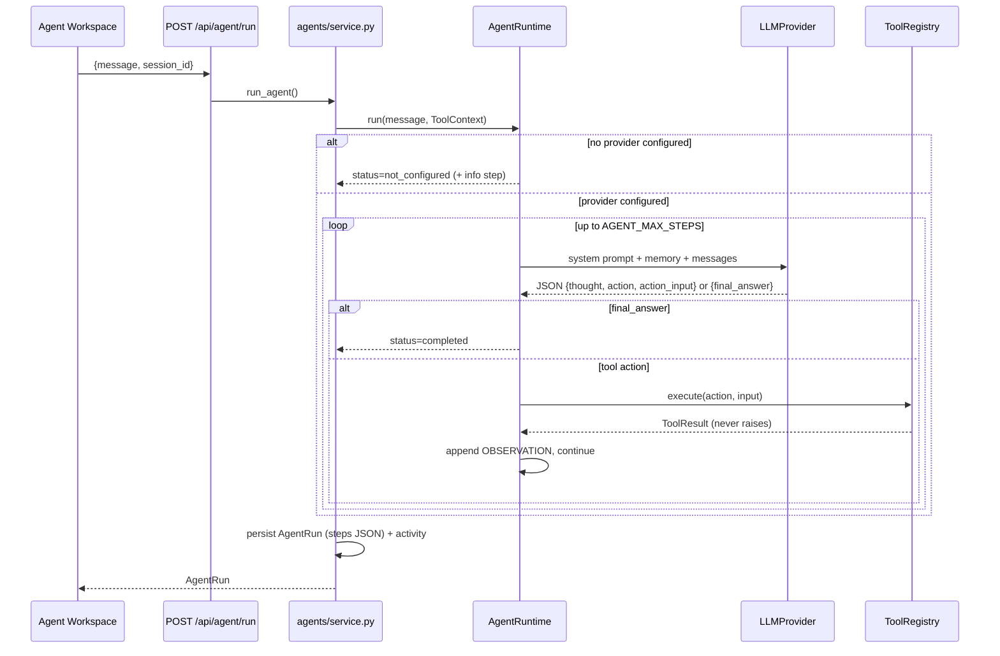

# Agent Architecture

## What exists today (real, not mocked)



## Components

| File | Role |
|---|---|
| `agents/runtime.py` | The loop. Provider-agnostic. Records every step (`thought`, `tool_call`, `tool_result`, `final`, `error`, `info`). |
| `agents/prompts.py` | `AGENT_ROLE` (customise per problem) + the JSON tool protocol + tool list |
| `agents/parser.py` | Extracts the JSON decision from model text (handles code fences / extra prose) |
| `agents/memory.py` | `AgentMemory` interface; `DatabaseMemory` replays recent completed runs per session |
| `agents/service.py` | Builds the runtime from settings, runs it, persists the run |
| `providers/*` | `LLMProvider.complete(system, messages) -> LLMResponse` for OpenAI-compatible and Anthropic APIs |
| `tools/*` | `Tool` interface, `ToolRegistry` (validation, timing, error capture), built-in tools |

## Capability checklist

| Capability | Status | Notes |
|---|---|---|
| Reasoning | ✅ | `thought` field each step |
| Tool selection | ✅ | Model chooses from registry description |
| Tool execution | ✅ | Validated input, timed, errors captured |
| Multi-step workflows | ✅ | Loop with observations, bounded by `AGENT_MAX_STEPS` |
| Memory | ✅ short-term | DB replay of last 6 turns; long-term/vector = extension |
| Task execution | ✅ | e.g. `create_task` writes to the DB |
| Execution logs | ✅ | Persisted `steps`, shown in UI |
| Error handling | ✅ | Provider errors, tool errors, unknown tools, bad JSON, step limit |
| Explicit planning step | ⏳ | Add a "plan first" call before the loop if the problem needs it |
| Streaming | ⏳ | `/api/agent/stream` returns 501 |
| Native function-calling | ⏳ | Optional optimisation per provider |

## Built-in tools

| Tool | Category | Effect |
|---|---|---|
| `get_current_time` | utility | Read-only |
| `calculator` | utility | Safe arithmetic (AST-based, no `eval`) |
| `get_project_progress` | workspace | Reads computed progress |
| `list_tasks` | workspace | Reads tasks (optional status filter) |
| `create_task` | workspace | **Writes** a task (logged in activity feed) |

These let you demo genuine tool use before domain tools exist. Remove or keep them once domain tools are added.

## Adding a domain tool (example)

```python
# workspace-api/app/integrations/weather.py
class WeatherClient(ExternalAPIClient):
    def __init__(self, api_key: str):
        super().__init__("https://api.example.com/v1", api_key=api_key)
    async def current(self, city: str) -> dict:
        return await self.get("/current", params={"city": city})

# workspace-api/app/tools/weather.py
class WeatherTool(Tool):
    name = "get_weather"
    description = "Current weather for a city."
    category = "domain"
    parameters = {"type": "object", "properties": {"city": {"type": "string"}}, "required": ["city"]}

    def __init__(self, client: WeatherClient):
        self.client = client

    async def run(self, ctx, **kw):
        try:
            return ToolResult(ok=True, output=await self.client.current(kw["city"]))
        except IntegrationError as e:
            return ToolResult(ok=False, error=str(e))

# workspace-api/app/tools/registry.py -> build_default_registry()
registry.register(WeatherTool(WeatherClient(settings.weather_api_key)))
```

Add `weather_api_key: str = ""` to `Settings` and `WEATHER_API_KEY=` to `.env.example`.

## When to adopt a framework

Stay with the built-in loop unless the problem needs: parallel/multi-agent graphs, human-in-the-loop checkpoints, durable long-running workflows, or heavy RAG pipelines. Then consider LangGraph (graphs/checkpoints) or LlamaIndex (RAG). Wrap it behind `AgentRuntime.run()` so routes and UI don't change.
