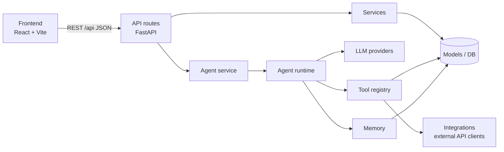

# System Architecture

## Layers

| Layer | Location | Responsibility | Must NOT |
|---|---|---|---|
| Frontend | `frontend/src` | Render state, call the API, show errors | Hold secrets, compute progress, call LLMs |
| API routes | `workspace-api/app/api/routes` | Validate input (Pydantic), call services, shape responses | Contain business or agent logic |
| Services | `workspace-api/app/services` | Business rules (progress, activity, phase status) | Know about HTTP |
| Agent | `workspace-api/app/agents` | Reasoning loop, memory, prompts, orchestration | Know about HTTP or a specific provider |
| Providers | `workspace-api/app/providers` | Talk to one LLM API behind `LLMProvider` | Know about tools or the DB |
| Tools | `workspace-api/app/tools` | Discrete capabilities with JSON-schema input | Know which model called them |
| Integrations | `workspace-api/app/integrations` | Typed clients for third-party APIs (retries, errors) | Know about the agent |
| Data | `workspace-api/app/models`, `core/database.py` | Persistence via SQLAlchemy | — |

## Request flows

**Edit a task** — `PATCH /api/tasks/7` → `routes/roadmap.py` validates `TaskUpdate` → updates row → `services.progress.sync_phase_status` → `services.activity.log_activity` → commit → `TaskRead`. Frontend reloads phases/progress.

**Run the agent** — `POST /api/agent/run` → `agents/service.run_agent` builds `AgentRuntime(provider, registry, DatabaseMemory)` → loop (see `AGENT_ARCHITECTURE.md`) → persists `AgentRun` with all steps → returns it. The UI renders the answer and the execution log from `steps`.

## Configuration

Everything environment-specific is in `.env` → `app/core/config.py` (`Settings`). Swapping SQLite→PostgreSQL, choosing an LLM provider/model, changing CORS or step limits are all config changes.

## Error handling

- Backend: `AppError` subclasses → `{"error": {"code", "message"}}` with proper HTTP status; validation errors → 422; unhandled → logged + 500.
- Agent: provider failures → run status `failed` with an `error` step; tool failures → `error` step fed back to the model as an observation; runaway loops → `max_steps`.
- Frontend: `ApiError` (network vs HTTP), toasts on mutation failures, `ErrorState` with retry on load failures, global offline banner via health polling.

## Extension points

| Need | Where |
|---|---|
| New domain entity | model + schema + route + types + api client (see `CLAUDE.md`) |
| New external API | `integrations/<service>.py` (subclass `ExternalAPIClient`) |
| New agent capability | `tools/<domain>.py`, register in `tools/registry.py` |
| Different LLM | `.env` (`AI_PROVIDER`, `AI_MODEL`, `AI_BASE_URL`) or new provider class |
| Long-term / vector memory | new `AgentMemory` implementation in `agents/memory.py` |
| Agent framework (LangGraph, etc.) | implement behind `AgentRuntime.run(message, ctx) -> AgentResult` |
| Background jobs | add a worker module; call from services, not routes |
| Streaming | implement `POST /api/agent/stream` (SSE) + switch `AgentWorkspace.send()` to a stream reader |

## Deployment (when needed)

- Frontend: `npm run build` → static `dist/` (Vercel / Netlify / any static host). Set `VITE_API_BASE_URL`.
- Backend: `uvicorn app.main:app --host 0.0.0.0 --port $PORT` (Render / Railway / Fly). Use PostgreSQL via `DATABASE_URL`, set `CORS_ORIGINS` to the frontend URL, `DEBUG=false`.
