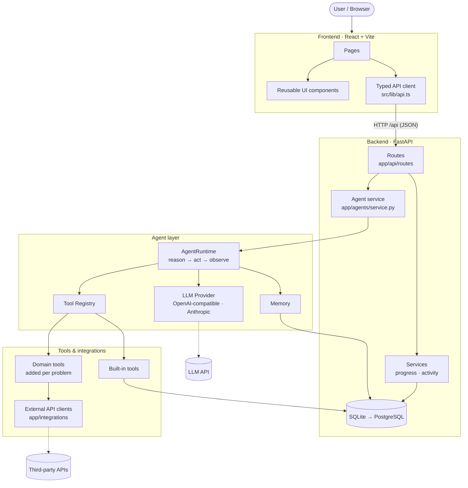

> **Note (Finora integration):** the FastAPI service described here now lives in `workspace-api/` (it was `backend/`). `backend/` is the Finora Spring Boot API. See the root `README.md`.

<div align="center">

# AgentForge

**A modular workspace for building, tracking and demoing agentic AI solutions.**

React · TypeScript · Tailwind CSS · FastAPI · SQLAlchemy · Provider-agnostic agent runtime

</div>

> **Finora AI (Spring Boot + React) setup, architecture, API and testing status → [`README_FINORA.md`](README_FINORA.md).** Integration change log → [`CHANGES_INTEGRATION.md`](CHANGES_INTEGRATION.md).

---

## Hackathon overview

AgentForge is our team's central workspace for an **Agentic AI Hackathon**. The challenge asks teams to:

1. Identify a real-world problem
2. Design a proper system architecture
3. Integrate tools and APIs
4. Build and demonstrate a functional end product
5. Develop AI agents that can reason, make decisions, use tools and execute tasks independently

The official problem statement had **not been announced** when this repository was created. So instead of guessing, this repo provides a production-quality *foundation*: a working dashboard, project management, documentation, and an agent runtime that becomes fully functional the moment a real model and domain tools are plugged in.

## Project objectives

- Give the team one place to define the problem, plan the work and track progress
- Provide a clean, layered architecture that can absorb any problem statement without rewrites
- Ship a real (not mocked) agent loop: reasoning → tool selection → execution → observation
- Keep AI providers, tools and external APIs swappable via configuration
- Make the final demo and presentation easy to prepare

## Tech stack

| Layer | Technology | Why |
|---|---|---|
| Frontend | React 19, Vite, TypeScript | Fast dev loop, typed API contract |
| Styling | Tailwind CSS v4 (design tokens in `index.css`) | Consistent dark SaaS UI, one-file theming |
| Backend | Python 3.10+, FastAPI, Pydantic v2 | Async, auto OpenAPI docs, validation |
| Database | SQLAlchemy 2 + SQLite | Zero setup; PostgreSQL via `DATABASE_URL` |
| AI | Provider-agnostic runtime (`httpx`) | OpenAI-compatible (OpenAI, Groq, OpenRouter, Ollama…) or Anthropic |
| Tests | pytest | API + agent-loop tests with a scripted fake model |

The frontend has only **two runtime dependencies** (`react`, `react-dom`). Routing, icons, charts and Markdown rendering are small in-repo modules so nothing breaks under hackathon time pressure.

## Features

| Page | What it does | Status |
|---|---|---|
| **Dashboard** | Overall % (computed), current phase, task stats, phase bars, upcoming milestones, activity feed, quick links | ✅ Functional |
| **Agent Workspace** | Chat UI, thinking indicator, run status, execution log (thoughts, tool calls, results), registered tools, example trace preview | ✅ UI + runtime functional · ⏳ needs an AI key |
| **Project Overview** | Editable problem statement, target users, solution, features, impact, objectives | ✅ Functional (intentionally blank) |
| **System Architecture** | Live layered diagram + agent loop diagram, CRUD for documented integrations | ✅ Functional |
| **Roadmap** | 9 default phases; add/edit/delete phases and tasks; deadlines; auto or manual status | ✅ Functional |
| **Progress Tracker** | Ring, distribution bar, per-phase bars, milestones, task tabs, contribution by assignee | ✅ Functional |
| **Documentation Center** | 10 Markdown sections, edit with live preview, stored in DB | ✅ Functional |
| **Team Workspace** | Members, roles, responsibilities, task assignment, contribution tracking | ✅ Functional |
| **Settings** | Project identity, AI provider status (read-only), environment guide | ✅ Functional |

## Architecture overview



**Key rule:** each layer only talks to the one below it. Routes never contain agent logic; the agent never knows about HTTP; tools never know which model called them. See [`docs/ARCHITECTURE.md`](docs/ARCHITECTURE.md) and [`docs/AGENT_ARCHITECTURE.md`](docs/AGENT_ARCHITECTURE.md).

## Repository structure

```
AgentForge/
├── README.md                  ← you are here
├── PROJECT_CONTEXT.md         ← permanent project memory (update every session)
├── CLAUDE.md                  ← instructions for AI coding assistants
├── ROADMAP.md                 ← 9-phase plan
├── TASKS.md                   ← current task board
├── .env.example               ← all configuration variables (copy to .env)
├── docs/
│   ├── ARCHITECTURE.md        ← layers, data flow, extension points
│   ├── AGENT_ARCHITECTURE.md  ← agent loop, providers, tools, memory
│   ├── API.md                 ← REST endpoint reference
│   └── PROBLEM_STATEMENT_PLAYBOOK.md ← what to do when the problem is announced
├── backend/
│   ├── requirements.txt / requirements-dev.txt
│   ├── app/
│   │   ├── main.py            ← FastAPI app, CORS, startup (create tables + seed)
│   │   ├── seed.py            ← default roadmap, docs, sample team
│   │   ├── core/              ← config (env), database, error handling
│   │   ├── models/            ← SQLAlchemy models
│   │   ├── schemas/           ← Pydantic request/response models
│   │   ├── api/routes/        ← HTTP endpoints (thin)
│   │   ├── services/          ← business logic (progress calculation, activity log)
│   │   ├── agents/            ← runtime loop, parser, prompts, memory, service
│   │   ├── providers/         ← LLM provider interface + implementations
│   │   ├── tools/             ← tool interface, registry, built-in tools
│   │   └── integrations/      ← base client for external APIs
│   └── tests/                 ← pytest: API + agent runtime
└── frontend/
    ├── package.json / vite.config.ts / tsconfig*.json
    └── src/
        ├── main.tsx / App.tsx ← providers + route table
        ├── index.css          ← Tailwind + design tokens
        ├── types/             ← API types (mirror backend schemas)
        ├── lib/               ← api client, router, hooks, formatting
        ├── components/        ← ui/, layout/, agent/, roadmap/, architecture/
        └── pages/             ← one file per page
```

## Installation

### Prerequisites

- **Python 3.10+** (`python --version`)
- **Node.js 20.19+ or 22+** (`node --version`) — required by Vite 7
- Git

### 1. Clone and configure

```bash
git clone <your-repo-url> AgentForge
cd AgentForge
cp .env.example .env          # Windows: copy .env.example .env
```

### 2. Backend

```bash
cd workspace-api
python -m venv .venv
source .venv/bin/activate        # Windows: .venv\Scripts\activate
pip install -r requirements-dev.txt
uvicorn app.main:app --reload
```

- API: http://localhost:8000 · Interactive docs: http://localhost:8000/docs
- On first start, `agentforge.db` is created in `backend/` and seeded with the default roadmap and docs.

### 3. Frontend (second terminal)

```bash
cd frontend
npm install
npm run dev
```

Open **http://localhost:5173**. In development, Vite proxies `/api` to `localhost:8000`, so no CORS or URL configuration is needed.

### Checks

```bash
cd workspace-api && pytest              # API + agent runtime tests
cd frontend && npm run build      # type-check + production build
```

## Environment variables

All variables live in `.env` at the repo root (see [`.env.example`](.env.example) for full comments).

| Variable | Default | Purpose |
|---|---|---|
| `DATABASE_URL` | `sqlite:///./agentforge.db` | SQLAlchemy URL (relative to `backend/`) |
| `SEED_SAMPLE_DATA` | `true` | Seed default roadmap/docs on an empty DB |
| `CORS_ORIGINS` | `http://localhost:5173,…` | Allowed frontend origins |
| `AI_PROVIDER` | `none` | `none` · `openai` · `anthropic` |
| `AI_MODEL` | — | Model ID as named by your provider |
| `AI_API_KEY` | — | Secret key (backend only, never in frontend) |
| `AI_BASE_URL` | — | OpenAI-compatible endpoint (Groq, OpenRouter, Ollama…) |
| `AGENT_MAX_STEPS` | `6` | Max reason/act iterations per request |
| `VITE_API_BASE_URL` | — | (frontend/.env) only when frontend is deployed separately |

**Connecting a model:** set `AI_PROVIDER`, `AI_MODEL`, `AI_API_KEY` in `.env`, restart the backend. The sidebar and Agent Workspace switch to “Connected”.

## Development roadmap

| # | Phase | Starting status |
|---|---|---|
| 1 | Problem Identification | Not started — waiting for announcement |
| 2 | Research and Requirement Analysis | Not started |
| 3 | Solution Design | Not started |
| 4 | System Architecture | In progress (foundation done) |
| 5 | AI Agent Development | In progress (runtime done, model pending) |
| 6 | Tool and API Integration | In progress (registry done, domain tools pending) |
| 7 | Frontend and Backend Integration | In progress (workspace wired) |
| 8 | Testing and Optimization | Not started |
| 9 | Final Demo and Presentation | Not started |

Details in [`ROADMAP.md`](ROADMAP.md); live status in the app's Roadmap page.

## Current implementation status

**Working now:** all 9 pages with real CRUD against the backend; dynamic progress calculation; activity feed; agent runtime with JSON-protocol tool calling, memory, step logging, error handling and a step limit; 5 real built-in tools; OpenAI-compatible and Anthropic providers; tests.

**Placeholder / not yet connected:** no AI key configured (agent returns `not_configured`); streaming endpoint returns `501`; no domain-specific tools, APIs or screens (deliberately — the problem statement isn't known); no authentication; schema changes use `create_all` (no Alembic yet).

## Future enhancements

Driven by the actual problem statement — evaluate, don't pre-install:

- Native function-calling per provider, or LangGraph for complex multi-agent graphs
- Streaming responses (SSE) into the chat UI
- Vector memory / RAG (pgvector, Chroma, Qdrant) if the problem involves documents
- Alembic migrations + PostgreSQL for deployment
- Authentication for multi-user demos
- Deployment (e.g. frontend on Vercel/Netlify, backend on Render/Fly/Railway)

## Team

Managed in the app's **Team** page. Placeholder members are marked *Sample* until replaced.

---

<sub>Built for an Agentic AI Hackathon · see [PROJECT_CONTEXT.md](PROJECT_CONTEXT.md) for the full project memory.</sub>
